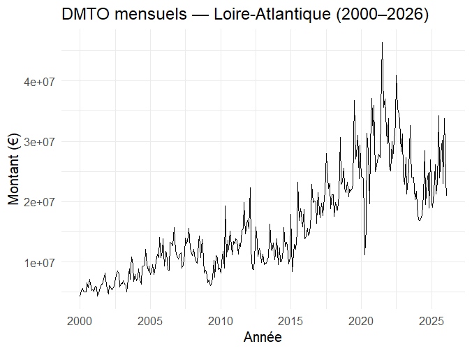
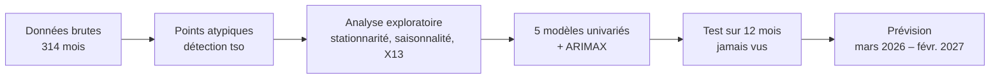
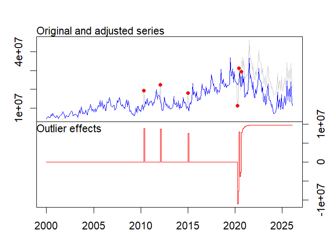
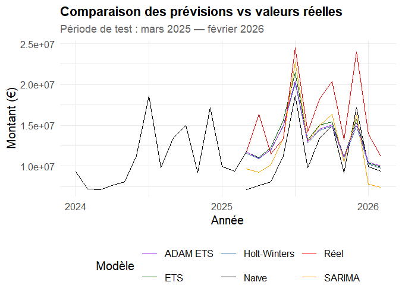
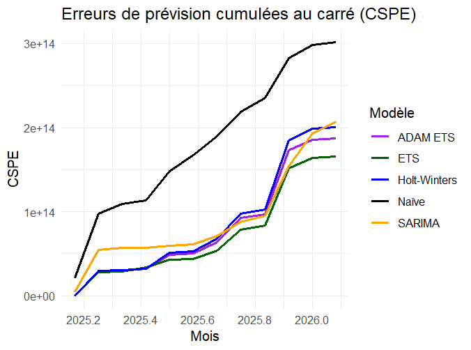
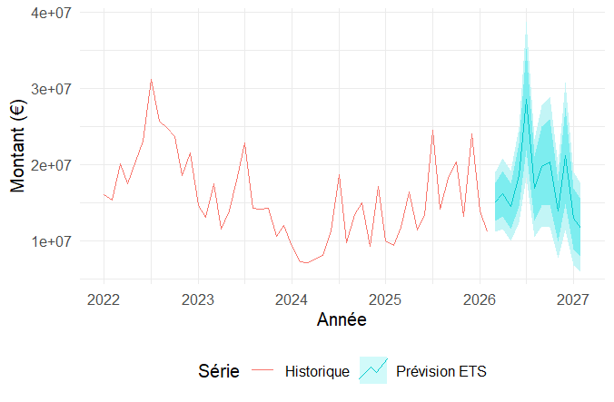

# Prévoir les recettes fiscales d'un Département : les droits de mutation en Loire-Atlantique


Mémoire de Master 1 Économétrie appliquée, IAE Nantes (2025-2026), sous la direction du Pr. Olivier Darné.

> **En bref.** Le Département de Loire-Atlantique prévoit ses droits de mutation (DMTO) avec un modèle Holt-Winters.
> J'ai comparé six méthodes de prévision sur 26 ans de données mensuelles.
> Le modèle **ETS(M,A,M)** fait **9 % d'erreur en moins** que Holt-Winters (RMSE) et **45 % de moins** que la prévision naïve.
> Sa supériorité sur Holt-Winters est **statistiquement significative** (test de Diebold-Mariano, p = 0,026).

---

## Le problème

Les DMTO sont les taxes perçues à chaque vente immobilière. Pour la Loire-Atlantique, la fiscalité locale qui les inclut représente **38 % des recettes** du Département.
Ces recettes suivent le marché immobilier : elles sont très volatiles (crise de 2008, Covid, remontée des taux en 2023).

Une erreur de 10 % sur la prévision, c'est **plusieurs dizaines de millions d'euros** d'écart sur le budget, et des dépenses à revoir en cours d'année.

**Question :** les méthodes modernes de prévision font-elles mieux que le modèle Holt-Winters utilisé aujourd'hui par le Département ?

## Les données

| Variable | Source | Période |
|---|---|---|
| DMTO mensuels (régime de droit commun) | DGFiP / IGEDD | janv. 2000 – févr. 2026 (314 mois) |
| Chômage catégorie A (Loire-Atlantique) | DARES | idem |
| Indice des prix à la consommation | INSEE | idem |
| Taux et encours des crédits à l'habitat | Banque de France | idem |



La série combine une tendance de long terme, une forte saisonnalité (pic en juillet, creux en janvier-février) et plusieurs chocs.

## La démarche



1. **Correction des points atypiques.** La détection automatique (`tsoutliers`) repère 6 chocs : 3 entre 2010 et 2015, et 3 liés au Covid en 2020 (confinement, rattrapage, boom post-Covid).
2. **Analyse exploratoire.** Tests ADF et KPSS (série intégrée d'ordre 1), six tests de saisonnalité, désaisonnalisation X13-ARIMA-SEATS. La saisonnalité explique 48 % de la variance.
3. **Modélisation.** Naïve saisonnière (référence minimale), Holt-Winters (modèle du Département), ETS, SARIMA, ADAM ETS, puis ARIMAX avec 4 variables macroéconomiques.
4. **Évaluation honnête.** Les modèles sont estimés jusqu'en février 2025 et jugés sur les 12 mois suivants, qu'ils n'ont jamais vus : RMSE, MAPE, R² hors échantillon et test de Diebold-Mariano.



## Les résultats

Période de test : mars 2025 – février 2026.

| Modèle | RMSE (€) | MAPE | R²OOS | DM vs naïve (p) | DM vs Holt-Winters (p) |
|---|---:|---:|---:|---:|---:|
| Naïve saisonnière | 5 011 201 | 29,1 % | 0,000 | — | 0,926 |
| Holt-Winters *(Département)* | 4 087 753 | 18,4 % | 0,335 | 0,074 | — |
| **ETS(M,A,M)** ✅ | **3 717 349** | **17,1 %** | **0,450** | **0,020** | **0,026** |
| SARIMA | 4 157 768 | 21,4 % | 0,312 | 0,060 | 0,555 |
| ADAM ETS | 3 949 364 | 17,5 % | 0,379 | 0,044 | 0,015 |
| ARIMAX (4 variables) | 3 510 277 | 17,0 % | 0,509 | 0,004 | 0,124 |



**Ce qu'il faut retenir :**

- **ETS bat Holt-Winters**, et l'écart est statistiquement prouvé. C'est le modèle retenu pour la prévision finale.
- **Un bon AIC ne garantit pas de bonnes prévisions.** SARIMA a le meilleur AIC en estimation, mais les moins bonnes prévisions hors échantillon : c'est du surapprentissage.
- **Les variables macroéconomiques n'apportent pas de gain prouvé.** L'ARIMAX a les meilleurs chiffres, mais son avantage sur Holt-Winters n'est pas significatif (p = 0,124). En pratique, il faudrait en plus prévoir ces variables, ce qui ajoute de l'erreur.



## La prévision 2026-2027

Le modèle ETS, ré-estimé sur toute la série, prévoit **environ 209 M€** de DMTO entre mars 2026 et février 2027, avec un pic en juillet 2026 (28,6 M€).



**Confrontation à la réalité.** Les montants de mars et avril 2026, publiés après l'étude, sont nettement au-dessus de la prévision (25,6 M€ et 22,6 M€ réels, au-delà de l'intervalle à 95 %).
Holt-Winters se trompe de la même façon. Ce rebond du marché illustre la limite des modèles univariés face aux retournements de cycle, et l'intérêt de mettre à jour le modèle chaque mois.

## Limites et pistes

- Fenêtre de test courte (12 mois) : les tests de Diebold-Mariano reposent sur peu d'observations.
- Les montants sont en euros courants : les hausses de taux de taxation (2011, 2015, 2025) gonflent la série sans que le marché soit plus actif.
- Autocorrélation résiduelle pour tous les modèles (test de Ljung-Box) : des non-linéarités subsistent.
- Pistes : modèles à changement de régime (Markov-Switching), sélection des variables par Lasso, prévision glissante (rolling origin) pour multiplier les points de test.

## Application interactive

Une application Shiny permet d'explorer la série, de comparer les modèles un par un et de voir la prévision avec ses intervalles de confiance.

```r
source("run_all.R")      # produit app/donnees_app.rds
shiny::runApp("app")
```


## Compétences mobilisées

`R` · séries temporelles (lissage exponentiel, ETS, SARIMA, ADAM, ARIMAX) · détection de points atypiques · désaisonnalisation X13 · tests statistiques (ADF, KPSS, Ljung-Box, Diebold-Mariano) · évaluation hors échantillon · visualisation (`ggplot2`, `plotly`) · application `Shiny` · code organisé et reproductible

## Auteur

**David DIOP** - Master 2 Économétrie appliquée, IAE Nantes.

📧 diopdaouda904@gmail.com
